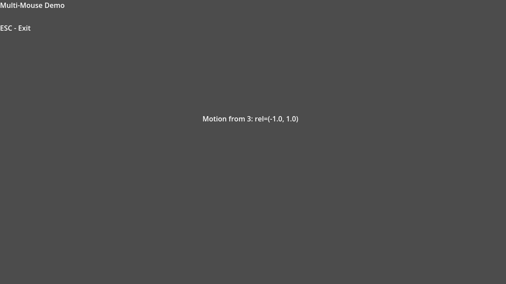
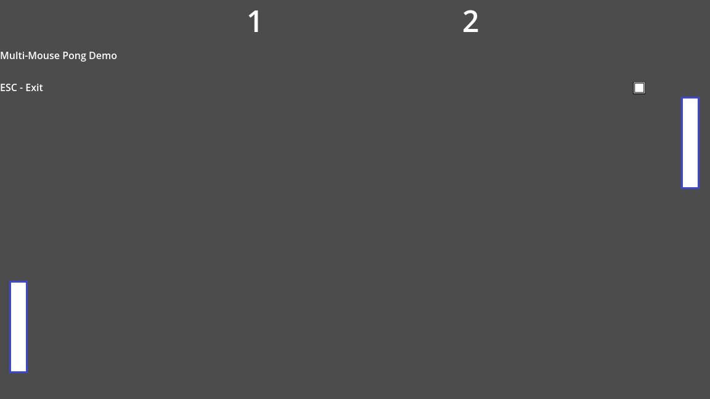
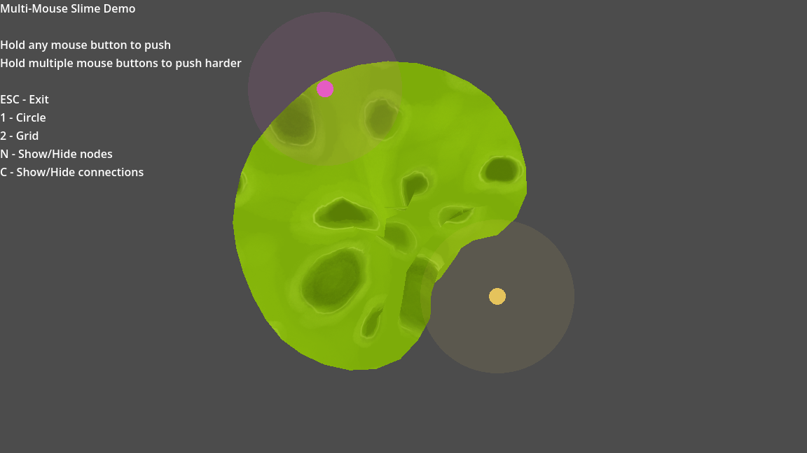

# Multi-Mouse — independent mouse and lightgun input for Godot

**Multi-Mouse** is a native GDExtension project for Godot that exposes input from individual physical pointing devices instead of combining every mouse into a single system cursor. It is intended for local multiplayer, multiple-mouse experiments, and lightgun-style input.

> **Development status:** The source includes Windows Raw Input support and a Linux/ManyMouse backend, but this repository does **not** currently contain the GDExtension descriptor or precompiled binaries required for a plug-and-play installation. Build output and Godot runtime compatibility have not been verified for this repository revision. Treat it as source code / work in progress, not a tested binary release.

## Features in the source

- **Per-device input:** independent movement and button events, with a numeric `event.device` identifier and `device_guid` metadata.
- **Windows Raw Input backend:** receives input from multiple mice and watches for device connection/disconnection.
- **Relative and absolute motion:** preserves raw absolute coordinates (commonly a 0–65535 range) for applications such as lightgun aiming. **Absolute coordinates are not automatically mapped to viewport pixels.**
- **Mouse buttons and scrolling:** left, right, middle, X1/X2, vertical and horizontal wheel handling in the Windows backend.
- **Godot-facing `MultiMouse` node:** signals and methods to manage input in a scene without a mandatory autoload.
- **Diagnostics hooks:** native `get_raw_input_count()` and `refresh_raw_input_registration()` methods.
- **Linux backend source:** ManyMouse integration with XInput2/evdev (not validated here).
- **Example projects:** Simple, Pong and Slime demo scenes.

These are implementation-level features identified from the repository, **not a guarantee of tested hardware or platform support**.

## Compatibility and current limitations

| Platform | Source status | Distribution status |
| --- | --- | --- |
| Windows x86-64 | Raw Input backend implemented | Build workflow present; no bundled DLLs |
| Linux x86-64 | ManyMouse backend included | Local build script present; not verified |
| macOS | No native Multi-Mouse backend in this repository | Not supported |

The current Windows build helper requests `godot-cpp` bindings for Godot API **4.7**, while the GitHub Actions workflow checks out `godot-cpp` **10.0.0-stable**. Check that these versions match the intended Godot runtime before distributing binaries.

**Important:** The tracked repository does not include an `addons/multi_mouse/*.gdextension` descriptor. Godot cannot load the native extension merely by copying the folder until a correctly configured descriptor and matching binary files are available.

## Repository structure

```text
addons/multi_mouse/     Godot node and editor plugin source
demo/                   Simple, Pong and Slime examples
docs/screenshots/       Demo screenshots
src/                    C++ GDExtension and platform backends
extern/manymouse/       Bundled ManyMouse sources
scripts/                Windows and Linux build scripts
.github/workflows/      On-demand Windows build workflow
```

## Building from source

### Windows

Requirements: Windows x86-64, PowerShell, Python/SCons, CMake, a compatible C++ build toolchain, and `godot-cpp`.

```powershell
git clone https://github.com/sillirion/Multi-Mouse-0.3.git
cd Multi-Mouse-0.3
git submodule update --init --recursive
./scripts/build_windows.ps1 -Target template_debug
./scripts/build_windows.ps1 -Target template_release
```

The script expects `extern/godot-cpp` to be present and writes libraries to `addons/multi_mouse/bin/win64/`. It is configured for Godot API 4.7; review the binding version and compiler setup before building.

**GitHub Actions:** Under **Actions → Build Windows Lightgun DLLs → Run workflow**, the existing manual workflow attempts debug and release builds and bundles their DLLs into the artifact `multi-mouse-lightgun-windows-x86_64`. An Actions artifact is a build output, **not** a published GitHub Release, and a successful run has not been verified as part of this documentation update.

### Linux

The repository also contains `scripts/build_linux.sh`, which builds against ManyMouse and native X11 dependencies. This path is not verified as part of this update. Review the local compiler, SCons, CMake and Godot binding requirements before using it.

## Godot API

After building and correctly registering the native GDExtension, the `MultiMouse` node provides:

| Member | Purpose |
| --- | --- |
| `attach_to_window(hwnd: int)` | Sets the target native window handle; `0` uses the backend's own input window on Windows |
| `enable()` / `disable()` | Starts or stops the input backend |
| `get_devices()` | Returns known device metadata |
| `request_poll()` | Polls queued native events (also called during node processing) |
| `motion(event)` | Emits an `InputEventMouseMotion` |
| `button(event)` | Emits an `InputEventMouseButton` |
| `device_connected(id, info)` | Reports a newly detected device |
| `device_disconnected(id)` | Reports a removed device |

Example scene script (assuming the extension is already loadable and a `MultiMouse` child exists):

```gdscript
@onready var multi_mouse: MultiMouse = $MultiMouse

func _ready() -> void:
    multi_mouse.motion.connect(_on_motion)
    multi_mouse.button.connect(_on_button)
    multi_mouse.attach_to_window(0)
    multi_mouse.enable()

func _on_motion(event: InputEventMouseMotion) -> void:
    var is_absolute := bool(event.get_meta("is_absolute", false))
    var raw_position: Vector2 = event.get_meta("raw_position", Vector2.ZERO)
    print("Device ", event.device, " absolute=", is_absolute,
          " raw=", raw_position, " relative=", event.relative)

func _on_button(event: InputEventMouseButton) -> void:
    print("Device ", event.device, " button=", event.button_index,
          " pressed=", event.pressed)
```

For absolute devices, interpret `raw_position` and `virtual_desktop` metadata in your own aiming/calibration logic. Do not assume `event.position` is expressed in window pixels.

## Demos

### Simple — device input inspection



A minimal example for observing mouse motion and buttons. Source: [demo/simple](demo/simple).

### Pong — two-mouse local multiplayer



An example of per-device input driving a local multiplayer game. Source: [demo/pong](demo/pong).

### Slime — interactive mouse-driven physics toy



An interactive example that responds to multiple pointing devices. Source: [demo/slime](demo/slime).

## Troubleshooting

- **`MultiMouseServer native singleton is not available`:** The GDExtension has not loaded. Confirm that the descriptor exists and points to compatible compiled libraries.
- **Devices are detected but aiming does not move:** Inspect `is_absolute` and `raw_position`; some lightguns report absolute packets rather than relative deltas.
- **Input disappears after a display-mode change:** The Windows backend includes a periodic Raw Input re-registration watchdog. Check whether the host application is overriding Raw Input registration.
- **Compilation fails:** Check the `godot-cpp` revision/API version, generated bindings, toolchain and native library path.

## Credits and licensing

This repository includes work derived from the original [Multi-Mouse project by duan-c](https://github.com/duan-c/Multi-Mouse), as indicated by its existing documentation. Refer to the upstream project for its original history.

Project license: [MIT](LICENSE). Bundled ManyMouse sources have their own license notice in [extern/manymouse/LICENSE.txt](extern/manymouse/LICENSE.txt). Verify any additional third-party asset attribution before redistribution.

## Contributing

Bug reports with the Godot version, operating system, device type, relevant logs, and reproducible steps are especially helpful. Changes to platform backends should be tested with at least two physical devices where possible.
